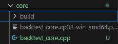

## Prerequisite
* 下載 [Microsoft C++ Build Tools](https://visualstudio.microsoft.com/zh-hant/visual-cpp-build-tools/) 
* 勾選以下套件並重新啟動電腦
    1. MSVC v143 - VS 2022 C++ x64/x86 建置工具
    2. Windows 11 SDK（視系統版本而定）
    3. 適用於Windows C++ 的 CMake 工具 
    4. 測試工具的核心功能 - 建置工具
    5. C++ AddressSanitizer
* 將`Microsoft C++ Build Tools`等相關設定新增到系統環境變數 [參考](https://github.com/bycloudai/InstallVSBuildToolsWindows)
* 安裝 TA-LIB到TA-LIB資料夾中
    1. [前往此網址]https://github.com/cgohlke/talib-build/releases
    2. 安裝對應版本的whl檔到TA-LIB資料夾中 (假設是3.10版本就下載ta_lib-0.6.3-cp310-cp310-win_amd64.whl)
    3. 更改專案資料夾中`requirement.txt`的內容，`TA-Lib @ file:///D:/<路徑>/TA-LIB/<檔案全名.whl>`
* 安裝 Python 3.7 ~ 3.11版本(這是由於Ta-Lib、finlab library只有支援到這些版本，使用python3.12版finlab那邊會有問題)，強烈建議一起安裝python launcher

## Installation
建立虛擬環境並安裝requirement
```
py -<版本> -m venv .venv
.venv\scripts\activate
pip install -r requirements.txt
```

## Compile CPython Extension Modules
1. Command Prompt執行以下指令
    ```
    cd core
    python setup.py build_ext --inplace
    ```
2. 執行過後會出現以下檔案
    

## Run
使用下面的指令來運作：
```
uvicorn src.main:app --reload
```